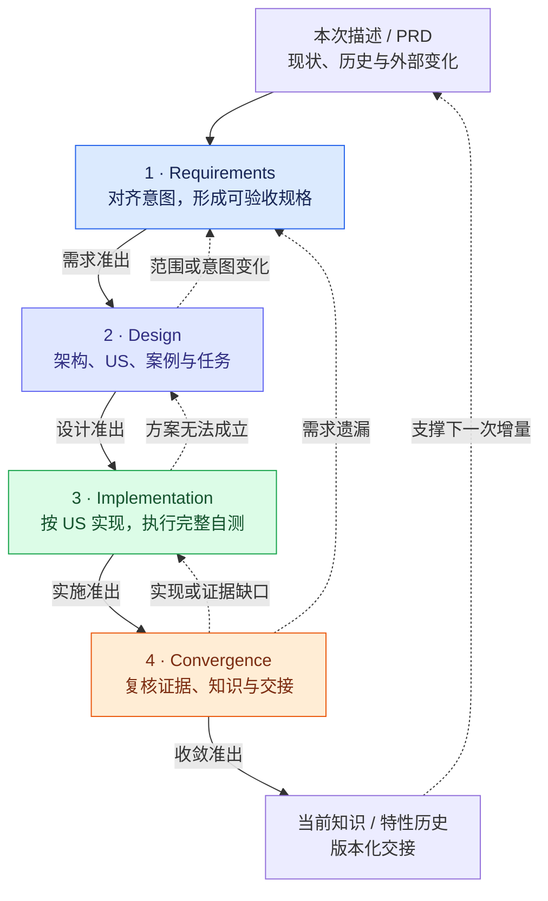
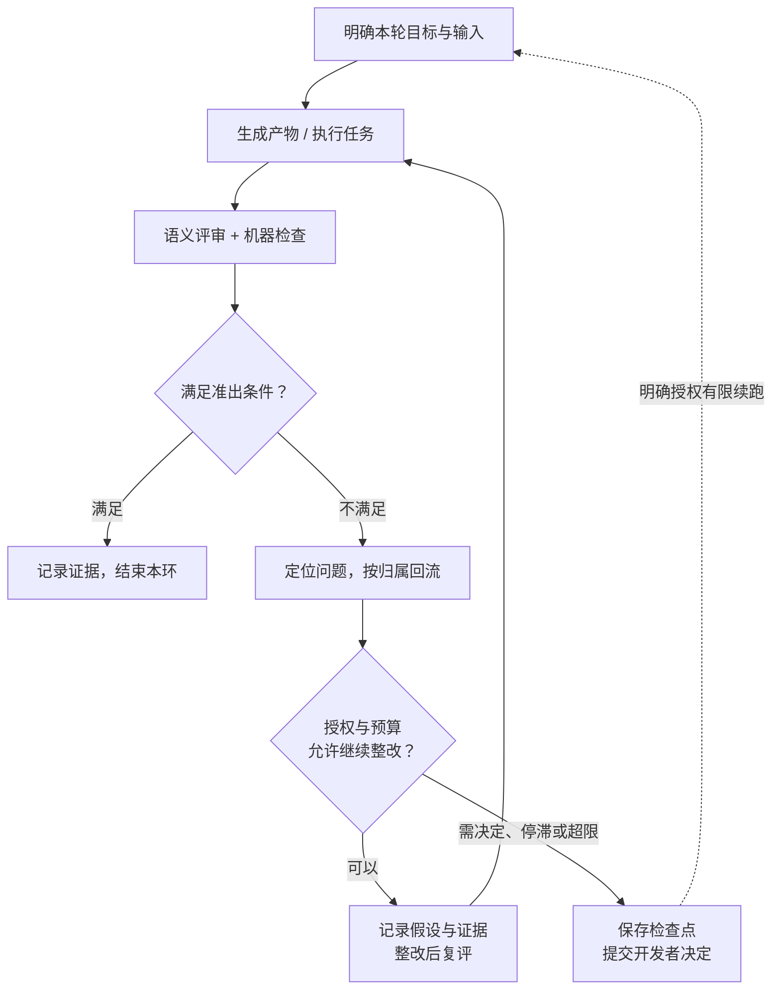
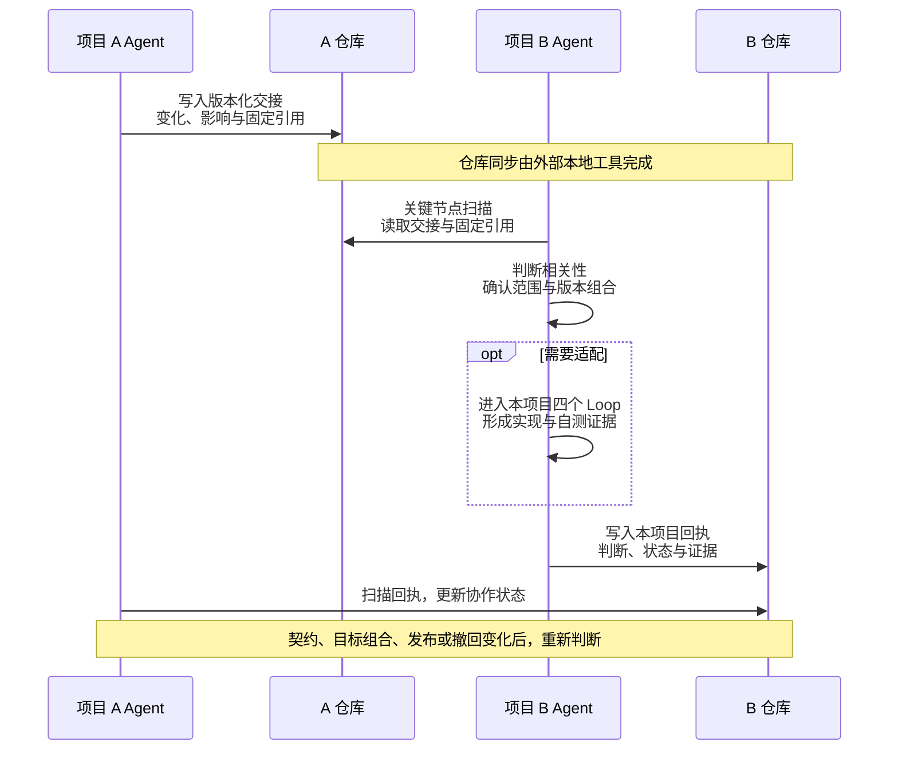

# SpecKit Loop Engineering

**面向存量项目的增量研发框架：以需求、设计、实施、收敛四个有界 Loop，连接用户意图、工程实现和可追溯证据。**

本项目将 Spec Kit 的规格驱动方法与 Claude Code Skill、本地 Python 运行时组合起来。团队从已有代码、项目约束和历史决策出发，通过四个 Loop 完成一次增量；每轮都明确输入、评估依据、回流方向和停止条件。

适合已有架构、持续发布、存在跨系统依赖的项目。运行时只依赖 Python 标准库和本地 Git，可以离线分发；日常入口仍是 `/loop-init` 与四个 `/loop-*`。

[四个 Loop](#四个-loop-如何协作) · [循环与预算](#循环如何结束) · [跨项目协作](#从单项目闭环到跨项目协作) · [安装与开始](#安装与开始)

## 为什么需要四个 Loop

存量项目的增量开发，要同时回答四件事：本次究竟改变哪些行为，如何沿用已有架构，哪些证据支持实现完成，以及下一次开发如何准确理解这次变化。

这些判断分布在不同阶段。需求遗漏应回到意图对齐，方案缺陷应回到设计，代码错误应回到实现。框架把问题按归属送回对应环节，保留同一问题的历史，并在最终收敛时核对规格、设计、代码、验证和项目知识是否一致。

Spec Kit 提供规格、计划与任务的组织方式；Four-Loop 为这些工作补上评估、整改、准出和升级机制。**准出条件满足，当前阶段才结束；预算耗尽，则带着证据交给开发者决定。**

## 四个 Loop 如何协作



实线表示准出后的主流程，虚线表示典型回流和知识复用。各阶段内部也会反复评估与修订；回流时保留问题身份和证据，原有确认若因内容或依赖变化而失效，需要重新确认。

| Loop | 要解决的核心问题 | 主要产物 |
| --- | --- | --- |
| Requirements | 做什么、保留什么，怎样才算满足需求？ | `spec.md`、上下文锁定、需求确认 |
| Design | 如何在现有架构内实现，怎样验证和恢复？ | 概要设计、US 设计、兼容方案、案例目录、任务与追溯关系 |
| Implementation | 实现是否符合设计，完整案例实际执行了什么？ | 业务代码、案例级原始结果、问题与风险记录 |
| Convergence | 最终成果是否一致，知识和交接是否反映实际状态？ | 收敛结论、刷新后的项目知识、特性历史、版本化交接 |

### 1. Requirements：把增量意图变成可验收规格

**循环节点：读取现状 → 扫描外部变化 → 对齐意图 → 编写规格 → 评审 → 修订。**

Agent 先读取项目当前摘要、相关特性历史、边界清单与用户描述或 PRD，区分本次新增、修改、保留和排除的行为。相关依赖固定到明确版本；现网状态、本次目标组合和开发中的外部设计分别记录。

可以从代码和资料确认的事实，由 Agent 调查。产品范围、兼容取舍等实质决策，通过逐轮提问与开发者对齐：先解决前置问题，再进入依赖它的下一层问题。规格使用稳定的 FR（功能需求）和 US（用户故事）标识，并为每个 US 写出可检查的验收条件。

评审发现事实缺口，就补充调查；发现业务歧义，就继续澄清。需求确认绑定当时的规格内容与目标依赖，后续相关变化会使旧确认失效。

**准出标准：** 规格中的 FR/US 明确，实质澄清问题已有结论，上下文与引用有效，遗留项有记录和处置，开发者已确认当前需求。此时交付的是获确认的需求依据，实现测试证据将在后续阶段产生。

### 2. Design：让架构、US 和验证计划同时成立

**循环节点：核对架构 → 概要设计 → US 设计 → 案例与兼容方案 → 任务拆解 → 一致性评审。**

概要设计说明模块职责、依赖方向、数据流和外部交互；US 设计把每个故事细化到实现行为、异常处理、边界条件和可执行案例。任务和案例共同形成追溯链：

```text
FR → US → 实施任务 → 自测案例 → 验收断言
```

设计需要同时处理存量行为与本次变化。Agent 维护整项目的功能案例目录，将单元、功能、回归、兼容和约定的恢复案例纳入其中。多个 US 即使共享一个 FR，也都要有自己的追溯关系。

涉及外部系统时，新接口及其采用依据必须进入本项目概要设计。尚未合入主干的设计可以作为显式选定的依赖，由本项目开发者确认；其实现状态和发布状态继续单独记录。新旧版本组合、兼容窗口和单模块回退限制也在这一阶段明确。

**准出标准：** 需求确认仍有效；概要设计、US 设计、任务、完整案例目录和追溯关系齐全；外部边界已评审；适用的版本组合与恢复约束有方案；有限资源预算已确定；当前设计获得开发确认。方案问题在本环修订，业务范围变化回到 Requirements。

### 3. Implementation：用实际执行支撑完成判断

**循环节点：选择最小 US → 实现 → 定向自测 → 诊断修复 → 整项目全功能执行 → 核对最终候选。**

局部开发以可独立验证的 US 或任务为单位。新增行为建立真实断言，缺陷先复现，再执行实现、测试和修复。发现设计或需求问题时回到对应 Loop，环境不足则保留环境缺口。

**每个增量都要运行完整登记的功能案例，包括存量案例。** 定向测试用于快速诊断，最终完整执行用于检查本次候选。运行时采集案例级结果及原始输出；命令退出码为零、目录里存在测试文件或 Agent 写下一句“通过”，都不足以证明完整执行。

结果分成四层记录，避免把风险决定写成测试结论：

| 层次 | 回答的问题 | 规则 |
| --- | --- | --- |
| 执行完整性 | 规定案例是否全部实际执行？ | 缺失、跳过、错误、超时保持未完整执行 |
| 自测结论 | 实际断言通过还是失败？ | 保留原始结果，摘要必须与原始结果一致 |
| 风险处置 | 已知失败必须修复，还是允许保留？ | 由开发者决定，记录依据和严重程度 |
| 阶段准出 | 当前证据和决定是否满足要求？ | 有依据的条件准出仍保留失败事实 |

证据绑定实际行为输入，包括代码、配置、依赖、测试、相关提示词及数据和环境声明。行为输入变化后，需要再次全量运行。

**准出标准：** 任务完成，全部规定案例实际得到通过或失败结果，证据对应最终候选，失败有相应处置，阶段检查通过。缺失、跳过、错误或超时不能通过风险接受绕成条件准出。

### 4. Convergence：把本次成果变成下一次开发的可靠起点

**循环节点：重扫变化 → 核对规格、设计与实现 → 分流问题 → 复核证据 → 刷新知识 → 形成交接。**

Agent 按已批准的范围检查遗漏、断言和外部边界。发现需求、设计或实现问题，分别回流；新增任务需要已有需求或已批准决策作为依据。整改继续使用原问题标识和预算。

最终候选未变且完整证据仍有效时，可以复用既有执行结果。行为输入改变则重新全量执行。收敛同时维护三类项目资产：

- **当前摘要与边界索引**：反映当前架构、有效约束、适用版本和已知缺口；旧视图保留来源与历史。
- **特性历史**：记录本次背景、核心改动、设计取舍、验证结果和遗留事项。
- **对外交接**：主动整理交互变化、受影响项目、兼容判断和待办，供其他项目的 Agent 读取。

**准出标准：** 实施证据有效，规格、设计、代码与确认一致，项目知识已刷新，特性历史和实现交接绑定被测候选，未解决事项及跨项目状态如实列明。自身收敛、消费者适配完成、联合兼容就绪和现网发布是独立状态。

## 循环如何结束

四个 Loop 共用“生成或执行—评估—整改—再评估”的控制逻辑。Agent 负责语义分析，运行时检查引用、覆盖、原始结果、预算和确认记录；开发者承担产品与架构取舍及风险决定。



默认预算按**同一问题**累计，跨 Loop 保留历史：

- 同一问题最多自动整改 **3 次**；连续 **2 次无实质进展**时提前升级。
- 正常需求澄清、等待回答、日常开发和计划内 TDD 初始红灯不计作失败整改。
- 本次增量还受有限总资源预算约束，依据项目基线自测成本和特性范围配置。
- 继续整改需要明确授权并增加有限额度；此前尝试、失败和证据仍然保留。

这些数字用于限制无效重复，并不代表三次内一定能修好。详见 [运行手册：收敛知识与预算](docs/INCREMENTAL-WORKFLOW.md#收敛知识与预算)。

## 首次接入：先建立可信的项目起点

`/loop-init` 为四个 Loop 准备项目基础。Agent 系统检查已有业务、架构、全部外部行为边界、构建运行、案例覆盖、发布恢复、历史知识和遗留问题，区分事实、批准的约束、推断与未知。

初始化会配置真实自测入口，在开发确认的有限预算内执行完整基线，并保存历史失败和缺口。历史问题可以由开发者决定优先级与处置，采集结果始终保留。安装成功只表示工具就绪。

项目知识采用“当前视图 + 特性历史”：当前视图持续刷新，特性历史保留变化背景和取舍。每次增量从二者形成上下文，收敛后再更新它们。

## 从单项目闭环到跨项目协作

框架围绕两层信息组织协作：

| 层次 | 关注内容 | 维护方式 |
| --- | --- | --- |
| 项目自身 | 当前架构、业务行为、代码、案例、特性历史 | 本项目持续刷新，作为增量上下文 |
| 外部边界 | API、事件、共享数据、SDK、配置、业务含义、错误与时序 | 生产方主动整理变化，消费方独立判断并回执 |

生产方完成设计或实现后，在自己仓库生成版本化 Markdown 交接。消费方在关键节点扫描已同步仓库，分析相关性，将需要采用的变化纳入本次规格和概要设计，再在自己仓库记录判断与证据。



各项目维护自己的记录，不跨仓写入，也不需要中央审批服务。未收到回执或读取失败时保留未知；接受延期表示已有处置，联合兼容是否就绪仍需独立判断。

### 设计必须覆盖新旧版本并存

以 A 为生产方、B 为消费方，相关交互需要设计并验证四种组合：

| 组合 | 需要说明和验证的行为 |
| --- | --- |
| 旧 A + 旧 B | 既有业务基线仍成立 |
| 新 A + 旧 B | A 升级后，旧消费者仍可使用约定能力 |
| 旧 A + 新 B | B 升级后，旧业务保持；新能力有明确降级方式 |
| 新 A + 新 B | 新能力满足双方约定 |

数据、事件或配置变化可能限制单模块回退。设计需说明兼容窗口、关闭能力、补偿、联合恢复或向前修复方案，并分别记录开发确认与实际验证结果。

月度版本、补丁版本及现网状态由权威发布记录描述。特性分支属于开发态；合入主干也不直接证明已上线。关键节点扫描读取本地已同步资料，运行时不提供常驻监听或自动 `fetch/pull`。

## Skill、运行时和项目资料如何分工

| 部分 | 职责 | 位置 |
| --- | --- | --- |
| Loop Skill | 指导 Agent 调查、提问、设计、实现、评审和回流 | `skills/loop-*/SKILL.md` |
| Spec Kit Skill | 执行规格、计划、任务等具体工作 | `skills/speckit-*/SKILL.md` |
| Python 运行时 | 执行案例、保存事实、校验引用与证据、检查准出 | `runtime/loop_runtime/` |
| 项目资料 | 保存当前知识、规格、设计、案例、决定与交接 | 业务项目的 `.specify/` 与 `specs/` |

安装后，运行时入口是 `.specify/scripts/loopctl.py`。Skill 调用它完成可重复检查，检查结果再反馈给 Agent。运行时不会独立证明业务需求正确，也不能认证本地确认文件中记录的人员身份。完整关系见 [Skill 与运行时代码](docs/SKILL-RUNTIME-MAP.md)。

## 验证范围

2.0 实现已在隔离环境完成 **65 项自动化测试**，覆盖上下文、完整自测、预算、版本组合、交接回执、发布记录、阶段准出和安装迁移；其中实际调用 Git、案例运行器和已安装 CLI。2026-10-29 的执行明细见 [验证记录](docs/VALIDATION.md) 和 [完整日志](docs/validation/unittest-2026-10-29.txt)。

真实项目仍需审阅边界清单、案例分母、断言与环境前提，并执行相应的业务联调和升级恢复验证。完整运行已登记案例不能保证不存在未知错误。原生 Windows 设置分支已有测试，PowerShell 安装及 Windows 原生运行尚未实测。

## 安装与开始

准备 Claude Code、Python 3.9+ 和 Git。下载本仓库或分发包，在包目录执行以下命令；项目路径须指向已存在的目标项目。

**macOS / Linux / WSL2：**

```sh
SKIP_SPECIFY_CLI=1 sh install.sh all /path/to/project
```

**原生 Windows PowerShell：** 本包的项目脚本还需要 Git for Windows 提供 Git Bash。

```powershell
$env:SKIP_SPECIFY_CLI = "1"
.\install.ps1 all C:\path\to\project
```

安装会向当前用户的 `~/.claude` 安装 Skill 和框架，并向目标项目安装运行时；保留既有配置与项目 constitution，对发生替换的内容备份。默认不下载依赖，也不要求安装 Spec Kit CLI。

重新启动 Claude Code，在目标项目依次执行：

```text
/loop-init
/loop-requirements 本次增量描述或 PRD 路径
/loop-design
/loop-implementation
/loop-convergence
```

`/loop-init` 之后需要配置真实案例目录、预算、项目标识和相关仓库映射。模板中的 `example: true` 只能作为格式参考。现网发布源和外部设计采用按项目实际情况配置。

本包在 macOS/Linux/WSL2 配置严格沙箱；原生 Windows 使用权限提示和 Hook 防护。两者隔离能力不同，平台条件见 [Claude Code 沙箱文档](https://code.claude.com/docs/en/sandboxing)。安装、备份、更新、内网 CLI 和权限配置详见 [安装说明](docs/INSTALLATION.md)。

## 深入阅读

- [运行手册](docs/INCREMENTAL-WORKFLOW.md)：命令、字段、四阶段准出和交换协议。
- [Skill 与运行时代码](docs/SKILL-RUNTIME-MAP.md)：Agent、执行器和项目记录的关系。
- [开发与验证](docs/DEVELOPMENT.md)：修改框架及运行测试的方法。
- [验证记录](docs/VALIDATION.md)：已经执行的检查与尚待项目验证的范围。
- [交付清单](MANIFEST.md)：2.0.0 组件与审计入口；当前交换协议为 `0.1-draft`。

## 来源与许可

Spec Kit Skill、模板和辅助脚本源自 [GitHub Spec Kit](https://github.com/github/spec-kit)，本项目在其基础上组合 Four-Loop、增量运行时和离线初始化能力。项目采用 [MIT License](LICENSE.md)，上游版权与许可见 [SPEC-KIT-LICENSE.md](SPEC-KIT-LICENSE.md)。
